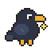
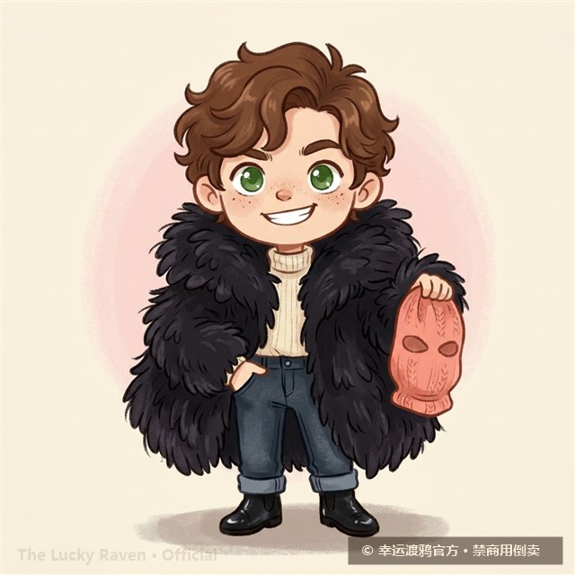

# 🐦 幸运渡鸦 · The Lucky Raven

**一款常驻内存仅约 `2.6MB` 的 Windows 极简桌面挂机收集小游戏**  
*平时写文档、敲代码、上网摸鱼、打游戏——每次敲键盘与点击鼠标，渡鸦都会悄悄为你衔来彩色礼盒！*

  
  
  

  
  
  
  
  

---

### 🎁 v2.10.0 手机版 (PWA) 上线福利：上线即领【2 个粉色限定礼盒 + 5 个金色传说礼盒】！

👉 **[📱 打开《幸运渡鸦》手机网页版（iOS / 安卓免安装即玩 · 支持添加到桌面与电脑存档互通）](https://rui36122-sketch.github.io/TheLuckyRaven/mobile/)**  
👉 **[🎮 进入游戏官网（支持网页试拆礼盒 + 国内免梯子高速直下）](https://rui36122-sketch.github.io/TheLuckyRaven/)**

---

## ⬇️ 快速下载（不到 240KB · 免安装运行库 · 双击即玩）

| 下载版本 | 国内高速加速直链（免梯子推荐） | GitHub 官方源 | 适用人群 |
| :--- | :--- | :--- | :--- |
| **一键安装程序 (.exe)** | [⚡ 点我高速下载](https://ghfast.top/https://github.com/rui36122-sketch/TheLuckyRaven/releases/download/v2.10.0/TheLuckyRaven_Setup.exe) | [GitHub 直链](https://github.com/rui36122-sketch/TheLuckyRaven/releases/download/v2.10.0/TheLuckyRaven_Setup.exe) | 推荐新手，1 秒安装 + 桌面图标 + 自带一键卸载 |
| **绿色便携版 (.zip)** | [⚡ 点我高速下载](https://ghfast.top/https://github.com/rui36122-sketch/TheLuckyRaven/releases/download/v2.10.0/TheLuckyRaven_Update.zip) | [GitHub 直链](https://github.com/rui36122-sketch/TheLuckyRaven/releases/download/v2.10.0/TheLuckyRaven_Update.zip) | 解压即玩，存档存于同级 `save\` 目录 |
| **手机版 (iOS/安卓 PWA)** | [📱 浏览器直开即玩](https://rui36122-sketch.github.io/TheLuckyRaven/mobile/) | [官网入口](https://rui36122-sketch.github.io/TheLuckyRaven/) | 无需下载安装包，添加到主屏幕当 App 玩，与电脑无损互导存档！ |

> 老版本电脑玩家无需重新下载，直接在游戏内点击 **「设置 → 检查更新」** 即可一键无损升级至 `v2.10.0`（支持公告栏、全平台存档互导，上线自动领取 **2 个粉色限定礼盒 + 5 个金色传说礼盒**）！

---

## 🌟 渡鸦世界的五大传奇 NPC 图鉴

在 36 格收藏室中拼齐传奇 NPC 专属套装，即可激活高额仿真战力倍率、**渡鸦专属变身形态**与全局强运被动：

| 传奇机械师 · 老冰 | 派对假面 · 阿皓 | 咖啡学者 · 阿宸 | 巨肌胆小男 · 伯格 | 羽氅型男 · 阿睿 |
| :---: | :---: | :---: | :---: | :---: |
|  |  |  |  |  |
| **老冰套 1.0 / 2.0** 老虎机保底不空 全局掉率升至 **3%** & 提品质 | **阿皓套 (2.5×)** 柔和治愈开箱音效 开箱越级概率 **+5%** | **阿宸套 (3.0×)** 每件物品锻造额外享 **1 次免费防碎保护** | **伯格套 (2.88×)** 渡鸦变壮且**头变尖尖** 双倍掉盒 + 锻造减失败率 | **睿套 (3.1×)** 渡鸦穿**黑色毛绒外衣** 炫酷音效 + 开盒双倍出货 |

> ❄️ *神秘传闻：伯格与阿睿两人都来自极其寒冷的地方，在收藏室同时激活两人的套装，或许会唤醒意想不到的奇妙变化哦……*  
> 👑 此外还有 **「秘境奇珍 · 卷心菜套装 (3.5×)」**（可爱卷心菜礼盒外观 + 锻造成功率永久 +5%）与 **「殿堂秘宝 · 黄金套 (2.8×)」**（售卖 +15% 仿真币 + 金盒掉率翻倍 + 全屏金碧辉煌殿堂特效）等你点亮！

---

## 🎮 核心玩法亮点

- **🐦 极致轻量无打扰后台掉落**：关闭主窗口即静默驻留托盘，常驻内存仅约 **2.6MB**、CPU 几乎 `0%`，完全不影响打字、学习、办公和打大型游戏；每次有效交互固定 1% 几率掉落礼盒（老冰套 2.0 升至 3%），待开礼盒永久保存。
- **🎨 8 阶品阶 · 133 件原创手绘像素藏品**：涵盖 **白（一般）→ 绿（正常）→ 蓝（稀有）→ 紫（史诗）→ 橙（传说）→ 红（神话）→ 粉（限定）→ 黑（遗留）**，每件物品均配手绘像素图标与趣味文案，开箱保底不低于礼盒品质。
- **🔨 渡鸦锻造炉（升星 & +8 飞升）**：强化 `+3` 晋升 2 星 (`★★`)、`+6` 晋升 3 星 (`★★★`)、`+8` 直接升阶变为高一级品质随机珍品！商店可购「开裂的龙鳞」防碎保护（每件最多 3 次，阿宸套共 4 次）。
- **🎰 三合一合成 & 幸运老虎机**：金色以下 3 件同阶随机向上合成；金色及以上 3 件相同物品直接合成 2 星 (`+3`)；多余礼盒可投老虎机，享 **99 抽必出神话 / 199 抽必出限定** 双保底。
- **🏛️ 36 格动态收藏室**：随时将藏品放入展柜累积仿真战力，也可随时一键「取回仓库」或直达「去锻造」。

---

## 🛡️ 隐私与安全郑重承诺

> **本软件仅统计键盘与鼠标的交互次数用于触发礼盒掉落，绝不记录任何具体按键内容、输入文本、密码、剪贴板或屏幕信息！**

- **纯本地单机存档**：个人数据仅保存在程序同级 `save\userdata.json`，零后台数据上传、零广告插件（仅在你手动点击「检查更新」时访问 GitHub 获取公开版本号）。
- **关于杀软/Windows 提示**：由于个人独立开发者未购买商业代码签名证书，且程序包含全局交互次数统计与防反编译混淆保护，Windows SmartScreen 或杀毒软件首次运行可能提示「未知发布者」，点击「更多信息 → 仍要运行」或加入信任即可放心游玩。

---

## 📜 版权与反倒卖声明

Copyright © 2026 **rui36122-sketch**. **All Rights Reserved.**  
本软件为作者原创闭源免费作品，详情请查阅 [LICENSE](LICENSE)。允许个人免费下载游玩与原样分享官网链接，**严禁任何形式的商业倒卖、付费网盘引流、去署名、二次打包或批量抓取美术资源商用**。

> 💡 欢迎在 [Issues](https://github.com/rui36122-sketch/TheLuckyRaven/issues) 投稿你想在游戏里看到的新脑洞物品、新套装或反馈建议！如果你喜欢这款摸鱼小游戏，欢迎点亮右上角的 ⭐ **Star** 支持一下！
